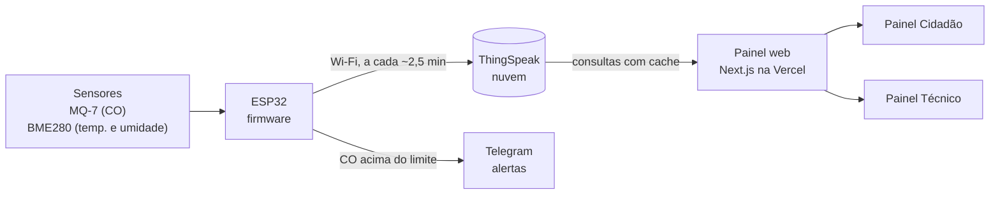

# ARSENS — Monitoramento de Monóxido de Carbono em Manaus

Sistema de Internet das Coisas (IoT) que mede **monóxido de carbono (CO)**, **temperatura** e
**umidade** em uma parada de ônibus da Av. Djalma Batista, em Manaus/AM, e publica os dados em um
painel web aberto: uma versão simples para o cidadão e uma versão técnica para pesquisadores.

> Projeto desenvolvido como **Trabalho de Conclusão de Curso (TCC)**.
>
> **Acesse o painel:** <https://projeto-arsens-kappa.vercel.app/> ·
> [Painel Técnico](https://projeto-arsens-kappa.vercel.app/dashboard)

---

## Sumário

- [Sobre o TCC](#sobre-o-tcc)
- [O problema e o objetivo](#o-problema-e-o-objetivo)
- [Como o sistema funciona](#como-o-sistema-funciona)
- [Funcionalidades](#funcionalidades)
- [Hardware](#hardware)
- [Firmware do ESP32](#firmware-do-esp32)
- [Tecnologias do painel web](#tecnologias-do-painel-web)
- [Estrutura do repositório](#estrutura-do-repositório)
- [Como rodar localmente](#como-rodar-localmente)
- [Publicação (Vercel)](#publicação-vercel)
- [Dados abertos para pesquisa](#dados-abertos-para-pesquisa)
- [Segurança e acessibilidade](#segurança-e-acessibilidade)
- [Limitações](#limitações)
- [Documentação completa](#documentação-completa)
- [Autoria](#autoria)

---

## Sobre o TCC

| | |
|---|---|
| **Título** | ARSENS — Monitoramento de Monóxido de Carbono com IoT |
| **Instituição** | Uninorte |
| **Curso** | Engenharia da Computação |
| **Orientador** | Raul Batalha |
| **Integrantes** | David Itamar, Fábio Azevedo e João Guilherme |
| **Ano** | 2026 |
| **Painel publicado** | <https://projeto-arsens-kappa.vercel.app/> |

---

## O problema e o objetivo

O monóxido de carbono é um gás **sem cor, sem cheiro e sem gosto**, liberado principalmente pela
queima de combustível dos veículos. Em vias de tráfego intenso, quem espera o ônibus fica exposto a
ele sem perceber. Em concentrações altas, causa dor de cabeça, tontura e cansaço; crianças, idosos,
gestantes e pessoas com problemas cardíacos são os mais sensíveis.

**Objetivo:** construir uma estação de baixo custo que meça o CO em um ponto real da cidade e
transforme essas leituras em informação clara, aberta e acessível:

- para o **cidadão**, um indicador simples de "como está o ar agora";
- para **pesquisadores**, gráficos, histórico e download dos dados brutos.

**Local de medição:** parada de ônibus *Atlantic Tower C/B*, Av. Djalma Batista, em frente ao
Millennium Shopping e ao lado da Uninorte (coordenadas -3.10042, -60.02397).

---

## Como o sistema funciona



1. O **ESP32** lê os sensores e calcula a concentração de CO.
2. A cada ciclo (~2,5 min), envia CO, temperatura, umidade e o dado bruto do sensor (Rs) ao
   **ThingSpeak**.
3. Se o CO passar do limite configurado, envia um **alerta no Telegram**.
4. O **painel web** busca os dados no ThingSpeak, aplica as regras (faixas de qualidade do ar,
   leituras com falha, botão de teste) e mostra tudo em tempo real, atualizando a cada 15 s.

---

## Funcionalidades

### Painel Cidadão (`/`)
- Status do ar em linguagem simples: **Qualidade Boa, Atenção, Risco Moderado ou Perigo**, cada um
  com cor, ícone e texto (legível também para daltônicos).
- Orientação prática para quem está no ponto de ônibus.
- Temperatura, umidade e situação do sensor ("Ao vivo" ou "Sem sinal").
- Régua educativa "Como ler o indicador" e conteúdo sobre o CO e seus efeitos.
- Enquanto o sensor está em calibração, o valor de CO fica oculto para não alarmar o público.

### Painel Técnico (`/dashboard`)
- Cards com CO, temperatura, umidade e resistência do sensor (Rs).
- **Gráfico de séries temporais** com filtro de período: 24 h, semana, mês ou intervalo de datas
  (até 90 dias).
- O gráfico mostra **uma sessão de medição por vez** (períodos contínuos de leitura), sem os longos
  intervalos vazios em que o sensor esteve desligado.
- Tabela com as últimas 20 leituras e diagnóstico de cada uma (OK, Erro ou Simulação).
- **Download dos dados** do período escolhido em Excel (.xlsx) ou CSV para Python/R.
- Mapa do ponto de coleta.

### Aplicativo instalável (PWA)
- Pode ser instalado na tela inicial do celular (Android e iPhone), sem loja de aplicativos.
- Tela própria quando não há internet, sem nunca mostrar uma leitura antiga como se fosse atual.

### Outros
- Modo claro e modo escuro.
- Versão compacta para celular.
- Alertas no Telegram enviados pelo próprio ESP32.

---

## Hardware

| Componente | Função |
|---|---|
| **ESP32** | Microcontrolador com Wi-Fi: lê os sensores, calcula o CO e envia os dados |
| **Módulo MQ-7** | Sensor de monóxido de carbono |
| **BME280** | Sensor de temperatura e umidade (I²C, endereço 0x76) |
| **MOSFET IRLZ44N** | Controla o aquecimento do MQ-7 por PWM (5 V / 1,4 V) |
| **Regulador LM2596** | Fornece os 5 V do circuito |
| **Divisor de tensão 10 kΩ / 20 kΩ** | Adapta a saída do MQ-7 à faixa do ADC do ESP32 |
| **Botão KY-004** | Botão de teste (simula um alerta) e entrada no modo calibração |
| **Protoboard 830 pontos** | Montagem do protótipo |

**Ligações principais:** MOSFET no GPIO 32, saída analógica do MQ-7 no GPIO 34, botão no GPIO 25.

---

## Firmware do ESP32

O código de exemplo está em [`codigoesp32_exemplo.txt`](codigoesp32_exemplo.txt) (Arduino IDE).
Ele **não contém as credenciais reais**: antes de gravar, troque os campos `SEU_..._AQUI` pelo
token do bot do Telegram, o chat ID e a Write API Key do ThingSpeak.

**Ciclo de medição do MQ-7:**
1. **60 s a 5 V** para limpar o sensor (aquecimento alto).
2. **90 s a 1,4 V** para medir (PWM com tensão eficaz de 1,4 V).
3. Leitura no fim da fase de 1,4 V e envio ao ThingSpeak.

**Cálculo do CO:**

```
Rs  = RL × (Vc − V_A0) / V_A0          resistência do sensor
R0  = Rs (em ar limpo) / 27,5          obtido na calibração
PPM = 99,042 × (Rs / R0) ^ −1,518      curva do datasheet do MQ-7
```

**Calibração:** segure o botão por 3 s ao ligar o ESP32, com o sensor em ar limpo. O valor de R0 é
calculado pela média de 10 ciclos e fica salvo na memória do ESP32.

**Campos no ThingSpeak:** `field1` CO (ppm) · `field2` temperatura (°C) · `field3` umidade (%) ·
`field4` Rs (Ω).

**Bibliotecas:** WiFiManager, Adafruit BME280, UniversalTelegramBot, ArduinoJson e ThingSpeak.

---

## Tecnologias do painel web

| Tecnologia | Uso |
|---|---|
| **Next.js 16** (App Router) + **React 19** | Páginas e componentes |
| **TypeScript** | Tipagem do código |
| **Tailwind CSS 4** | Estilos e modo escuro |
| **Recharts 3** | Gráfico de séries temporais |
| **ExcelJS** | Geração da planilha para download |
| **ThingSpeak** | Armazenamento das leituras na nuvem |
| **Vercel** | Hospedagem |

---

## Estrutura do repositório

```
├── src/
│   ├── app/
│   │   ├── page.tsx                 Painel Cidadão (/)
│   │   ├── dashboard/page.tsx       Painel Técnico (/dashboard)
│   │   ├── dashboard/export/        Download do histórico (.xlsx e CSV)
│   │   ├── sobre/page.tsx           Página "Sobre o Projeto"
│   │   └── layout.tsx, manifest.ts  Layout geral e manifesto do PWA
│   ├── components/                  Cards, gráfico, filtro, tabela, mapa, cabeçalho...
│   └── lib/
│       ├── thingspeak.ts            Busca no ThingSpeak, cache, sessões e médias
│       ├── co.ts                    Regras do CO (faixas, simulação, falhas)
│       ├── period.ts                Filtro de período do gráfico
│       └── feed.ts                  Tipos dos dados e status de cada leitura
├── public/                          Ícones, service worker (sw.js) e tela offline
├── scripts/generate-icons.mjs       Gera os ícones do PWA a partir do logo
├── codigoesp32_exemplo.txt          Firmware do ESP32 (sem credenciais)
└── explicacao_codigo_dashboard.txt  Documentação detalhada do código
```

---

## Como rodar localmente

**Pré-requisito:** [Node.js](https://nodejs.org/) (versão LTS).

1. Clone o repositório e instale as dependências:

   ```bash
   git clone https://github.com/fabioazevedo26/Projeto-Arsens.git
   cd Projeto-Arsens
   npm install
   ```

2. Crie o arquivo `.env.local` na raiz do projeto:

   ```env
   THINGSPEAK_CHANNEL_ID=3387680
   THINGSPEAK_READ_API_KEY=sua_read_api_key
   TELEGRAM_BOT_URL=https://t.me/seu_bot
   CO_CALIBRADO=false
   ```

   | Variável | Descrição |
   |---|---|
   | `THINGSPEAK_CHANNEL_ID` | ID do canal no ThingSpeak |
   | `THINGSPEAK_READ_API_KEY` | Chave de **leitura** do canal (o canal é privado) |
   | `TELEGRAM_BOT_URL` | Link do bot de alertas, usado no botão "Alertas no Telegram" |
   | `CO_CALIBRADO` | `true` mostra o valor e o status do CO no Painel Cidadão; qualquer outro valor mostra "Sensor em calibração" |

   O painel usa **somente a chave de leitura**. A Write API Key fica apenas no firmware do ESP32.

3. Rode em modo de desenvolvimento:

   ```bash
   npm run dev
   ```

   Abra <http://localhost:3000> (Painel Cidadão) ou <http://localhost:3000/dashboard> (Painel Técnico).

**Outros comandos:**

| Comando | O que faz |
|---|---|
| `npm run build` | Gera a versão de produção |
| `npm start` | Roda a versão de produção (necessário para testar o PWA) |
| `npm run lint` | Verifica o código com o ESLint |

---

## Publicação (Vercel)

1. Importe o repositório na [Vercel](https://vercel.com/).
2. Em **Settings > Environment Variables**, cadastre as mesmas variáveis do `.env.local`.
3. Com o repositório conectado à Vercel, cada push na branch `main` gera uma nova publicação.

---

## Dados abertos para pesquisa

No Painel Técnico, os botões abaixo da tabela baixam **todas as leituras do período escolhido no
gráfico**:

- **Excel (.xlsx):** colunas de data, hora, CO, temperatura, umidade, Rs e status, com datas e
  números prontos para filtrar e fazer gráficos. Uma segunda aba, "Sobre os dados", traz o local,
  os sensores, o fuso horário, o período exportado e o significado de cada status.
- **CSV padrão (Python/R):** separador `,` e decimal `.`, com data/hora em UTC e em Manaus.

**Status de cada leitura:**
- **OK:** leitura válida.
- **Erro:** falha do sensor (valor 0,00 ou vazio).
- **Simulação:** botão de teste acionado (CO = 999,9), não é uma medição real.

---

## Segurança e acessibilidade

**Segurança**
- As chaves do ThingSpeak ficam só no servidor e nunca chegam ao navegador.
- As consultas ao ThingSpeak passam por um cache compartilhado entre todos os visitantes, o que
  evita sobrecarregar o serviço.
- Cabeçalhos de segurança em todas as páginas (Content-Security-Policy, X-Frame-Options e outros).

**Acessibilidade**
- Status com tripla codificação (cor, ícone e texto) e contraste no padrão WCAG AA.
- Botões com área de toque de no mínimo 48 px.
- Link "Pular para o conteúdo" e foco do teclado bem visível.
- Respeita a opção "reduzir movimento" do sistema.
- Botão para pausar a atualização automática.
- Tabela e mudanças de status preparadas para leitores de tela.

---

## Limitações

- O MQ-7 é um sensor de **baixo custo**: as leituras são **indicativas**, não certificadas.
- A faixa confiável do MQ-7 vai de cerca de 20 a 2000 ppm. Abaixo de ~20 ppm, os valores são
  apenas indicativos.
- A precisão depende da calibração (R0), feita em ar limpo após o pré-aquecimento do sensor.
- As leituras até 17/10/2026 são inválidas (o firmware antigo tinha um erro de configuração do
  ADC, já corrigido) e por isso **não aparecem no painel nem no download**. Elas continuam
  guardadas no ThingSpeak.
- O sensor não funciona de forma contínua: há períodos sem leitura, que o gráfico separa em
  sessões de medição.

---

## Documentação completa

A explicação detalhada de cada parte do código (regras de negócio, cache, gráfico, PWA, design,
acessibilidade e pontos de atenção) está em
[`explicacao_codigo_dashboard.txt`](explicacao_codigo_dashboard.txt).

---

## Autoria

Projeto desenvolvido como Trabalho de Conclusão de Curso de **Engenharia da Computação** na
**Uninorte**, em Manaus/AM, 2026.

| Integrantes |
|---|
| David Itamar |
| Fábio Azevedo ([@fabioazevedo26](https://github.com/fabioazevedo26)) |
| João Guilherme ([@JoaoGuilhermePinho](https://github.com/JoaoGuilhermePinho)) |

**Orientador:** Raul Batalha
